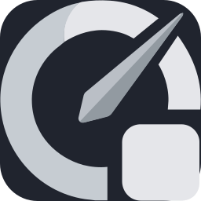

<p align="center">
  
</p>

# TokenBar

AI subscription usage monitor for your terminal — and optionally in the browser.

Tracks quota usage for AI coding assistants — OpenCode Go, ZAI, and Grok — and
displays live, color-coded usage bars in a TUI or a local web dashboard.


## Dashboard

```
┌─ TokenBar · last 14:32:05 · every 60s ─────────────── ● live ─┐
│                                                               │
┌─ Personal · opencode go ──────────────────────────── synced ──┐
│ 5h       ████████████████░░░░░░░░░  62%  resets 3d 12h        │
│ Weekly   █████████████████████████  98%  resets 3d 12h        │
└───────────────────────────────────────────────────────────────┘
│                                                               │
┌─ Work · zai ───────────────────────────────────────── synced ─┐
│ 5h       ████████████░░░░░░░░░░░░  48%  resets 4h 23m         │
│ Weekly   ██████████████░░░░░░░░░░  56%  resets 6d             │
└───────────────────────────────────────────────────────────────┘
│                                                               │
│              [r] refresh   [q] quit                           │
└───────────────────────────────────────────────────────────────┘
```

Bars are coloured **green** (<60%), **yellow** (60–84%), and **red** (≥85%).
When a fetch fails the last known data is shown as **stale** with the error
message and elapsed time.

## Features

- Multi-account TUI dashboard with per-account usage bars
- Optional **web dashboard** (`tokenbar serve`) for browser / phone on localhost
- Automatic refresh on a configurable interval (default 60 s)
- Three providers: **OpenCode Go** (cookie, API key, or a key referenced
  from a local store), **ZAI** (API key), **Grok** (OAuth)
- Embedded browser login for OpenCode Go — no manual cookie hunting
- Embedded browser login for Grok — device-code OAuth
- CLI subcommands for status checks and session management
- Works offline for display once sessions are saved (live bars still poll providers)

## Installation

### Prerequisites

- [Rust toolchain](https://rustup.rs) (stable, edition 2021)
- **Windows**: [WebView2 Runtime](https://developer.microsoft.com/en-us/microsoft-edge/webview2/)
  (required for the embedded browser login; on Windows 11 it is usually
  pre-installed)

### Build from source

```shell
git clone <repo-url>
cd tokenbar
cargo install --path .
```

This builds the binary and installs it to `~/.cargo/bin/tokenbar`
automatically. Ensure that directory is on your `PATH`.

## Quick start

```shell
# Log in to an OpenCode Go account (opens a browser window)
tokenbar account login personal

# Log in to a ZAI account
tokenbar account login work --provider zai --api-key sk-abc123...

# Log in to a Grok account (opens browser)
tokenbar account login grokme --provider grok

# Terminal dashboard
tokenbar

# Web dashboard on this machine
tokenbar serve
# then open http://127.0.0.1:8790 in a browser
```

## Web dashboard (localhost)

Serve a mobile-friendly usage page using the same accounts and poller as the TUI.

```shell
# Default: 127.0.0.1:8790 (loopback only — not reachable from other devices)
tokenbar serve

# Custom port
tokenbar serve --port 8790

# Bind address (prefer loopback unless you know you need LAN)
tokenbar serve --bind 127.0.0.1 --port 8790
```

1. Install and log in as in [Quick start](#quick-start).
2. Run `tokenbar serve`.
3. Open **http://127.0.0.1:8790** (or `http://localhost:8790`).
4. Leave the process running; the page auto-refreshes on the same interval as
   the TUI. Reload the browser tab anytime for a fresh paint.
5. Stop with `Ctrl+C`.

| Path | Description |
|---|---|
| `GET /` | Usage UI |
| `GET /api/status` | JSON snapshot of all accounts |
| `GET /api/key-sources` | Labels available in the local key stores (never values) |
| `POST /api/refresh` | Force a poll cycle |
| `GET /healthz` | Liveness check |
| `GET /icon.svg` | Header mark (transparent, edge-to-edge) |
| `GET /favicon.png` | Tab / home-screen icon (transparent PNG) |
| `GET /favicon.svg` | SVG favicon (same mark) |
| `GET /apple-touch-icon.png` | iOS home-screen icon |

**Security notes**

- Default bind is **127.0.0.1** so only your machine can connect.
- The server has **no built-in login**. Do not expose it on `0.0.0.0` or a
  public port without your own reverse proxy / auth (e.g. SSH tunnel,
  Tailscale, or Cloudflare Access + Tunnel).
- Sessions and API keys stay in your local data directory; the web UI only
  serves usage percentages and labels.

Optional: put `tokenbar serve` under your OS service manager (systemd user unit,
launchd, etc.) if you want it always on. That is environment-specific and not
required for normal use.

## CLI reference

| Command | Description |
|---|---|
| `tokenbar` | Launch the TUI dashboard |
| `tokenbar serve` | Web dashboard on `127.0.0.1:8790` |
| `tokenbar account list` | Print account status (session age, workspace IDs) |
| `tokenbar account login <name>` | Log in to an OpenCode Go account (opens webview) |
| `tokenbar account login <name> --provider zai --api-key <key>` | Save a ZAI API key |
| `tokenbar account login <name> --provider opencode_go --api-key <key>` | Save a validated OpenCode Go API key |
| `tokenbar account login <name> --provider opencode_go --key-source hermes:lks00` | Adopt a key from a local store |
| `tokenbar account login <name> --provider grok` | Log in to Grok (opens webview) |
| `tokenbar account login --cookie <name> --cookie <str>` | Manually set a session cookie |
| `tokenbar account logout <name>` | Remove a session |
| `tokenbar account list` | List saved sessions |
| `tokenbar account list --details` | Print sessions as JSON |
| `--config <path>` | Override path to `auth.toml` |
| `--data-dir <path>` | Override data directory |

## Configuration

`auth.toml` lives in the platform config directory:

- macOS / Linux: `~/.config/tokenbar/auth.toml`
- Windows: `%APPDATA%\tokenbar\auth.toml`

```toml
refresh_interval_secs = 60
request_timeout_secs = 15
max_concurrent_fetches = 4

[[accounts]]
name = "Personal"
provider = "opencode_go"
api_key_source = "hermes:lks00"   # optional: reference a key in a local store

[[accounts]]
name = "Work"
provider = "zai"
api_key = "sk-..."
```

Session cookies and OAuth tokens are stored in `sessions.json` in the same
data directory. Do not commit that directory.

### API key sources (`api_key_source`)

Instead of duplicating an OpenCode Go API key into `auth.toml`, an account can
**reference** a key held in another local store. TokenBar resolves the
reference at fetch time — no copy is stored, and rotating the key in its store
is picked up automatically:

```toml
[[accounts]]
name = "lks00"
provider = "opencode_go"
api_key_source = "hermes:lks00"      # read the key from Hermes' credential pool
```

Two stores are supported (prefix matching is case-insensitive; surrounding
whitespace is trimmed):

| Source | Store | Selection |
|---|---|---|
| `hermes:<label>` | `~/.hermes/auth.json`, pool `opencode-go` | entry with that `label` (e.g. `lks00`, `laut9810`) |
| `opencode` | opencode's own `auth.json` — `$OPENCODE_DATA_DIR/auth.json`, else `$XDG_DATA_HOME/opencode/auth.json`, else `~/.local/share/opencode/auth.json` | the single `opencode-go` api entry |

Notes:

- **Env-sourced Hermes credentials** (`"source": "env:OPENCODE_GO_API_KEY"`)
  carry no key in the file — Hermes resolves them from the environment at its
  own runtime. TokenBar reports them as *not usable here* (in
  `GET /api/key-sources` and errors) instead of sending an empty bearer
  token; pick a `manual` credential.
- Hermes' `last_status` / `last_error_code` fields (e.g. a 429
  `GoUsageLimitError` = valid key, capped window) are pool bookkeeping and are
  surfaced as display metadata only — never as this account's usage meters.
- **Precedence:** an explicit `api_key` always wins over `api_key_source`,
  which wins over the scraped session cookie. Adopting a key source
  (`--key-source` or the dashboard) therefore drops the account's previously
  pasted key so the source actually takes effect; pasting a key again simply
  switches back.
- A configured-but-**broken** source (unknown label, missing store file)
  surfaces as an error on that account rather than silently falling back to
  the cookie — you asked for that specific store.

Adopt one from the CLI (resolved and validated against the live usage API
first, exactly like `--api-key`):

```shell
tokenbar account login lks00 --provider opencode_go --key-source hermes:lks00
```

The web dashboard offers the same choices: the credential form lists what the
local stores contain (`GET /api/key-sources`, labels only) next to the paste
field, and the credential row shows where an active key comes from
(`api key · hermes:lks00 · sk-3YL…`). `tokenbar check` warns on
syntactically unsupported sources.

## Providers

### OpenCode Go

Cookie-based provider for [opencode.ai](https://opencode.ai). The login
command opens an embedded browser; once authenticated, the session cookie is
captured automatically and saved to `sessions.json`.

### ZAI

API-key-based provider for [z.ai](https://z.ai). Provide the API key via
`--api-key` during login. Usage data is fetched from the ZAI REST quota
endpoint.

### Grok

OAuth provider for [xAI Grok](https://grok.com) / SuperGrok (device code,
same idea as `grok login --device-auth`). Login opens **auth.x.ai** in a
webview; approve access (enter the printed user code if asked). Tokens are
stored per account in `sessions.json`.

```shell
tokenbar account login alice --provider grok
tokenbar account login bob --provider grok
```

Usage is fetched with the access token from
`https://cli-chat-proxy.grok.com/v1/billing?format=credits` (Weekly bar).

## Keybindings (TUI)

| Key | Action |
|---|---|
| `r` | Force refresh now |
| `q` | Quit |

## Project structure

```
assets/
└── logo.png             # README / marketing logo
src/
├── main.rs              # Entry point, CLI definition
├── config.rs            # auth.toml load/save
├── session.rs           # sessions.json persistence
├── login.rs             # Embedded browser login (wry + tao)
├── model.rs             # Data types (Account, UsageSnapshot, …)
├── keysource.rs         # api_key_source resolution (hermes / opencode stores)
├── error.rs             # Error types
├── app.rs               # App state and background poller
├── api/
│   ├── mod.rs           # Provider dispatch
│   ├── opencodego.rs    # OpenCode Go scraping + usage API
│   ├── zai.rs           # ZAI API client
│   └── grok/            # Grok OAuth + billing
├── tui/
│   ├── mod.rs           # TUI event loop and layout
│   └── widgets.rs       # Account card and meter rendering
└── web/
    ├── mod.rs           # HTTP server + /api/status
    └── static/
        ├── index.html   # Mobile dashboard UI
        ├── icon.svg     # Header icon (no plate)
        ├── favicon.svg  # Favicon source (no plate)
        └── favicon.png  # Raster favicon
```

## Running tests

```shell
cargo test
```

## License

MIT
